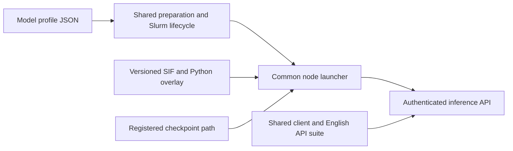

# Common code, model profiles and runtime registration

The current framework is `releases/inference/2026-10-19-docs1`, selected by `scripts/inference` and based on Qwen-tested source `2026-10-19-r2`. It provides GLM, DeepSeek and Qwen profiles with shared launch/client code. Earlier snapshots preserve the original GLM/DeepSeek GPU evidence and historical installation scripts.



## Responsibilities

| File | Responsibility |
| --- | --- |
| `inference.py` | Profile validation, manifest checks, private preparation, asset checks, Slurm submission and operator CLI |
| `node.py` | Common container environment, explicit mounts, per-node vLLM arguments and approved pre-start hooks |
| `serve_model.sbatch` / `lifecycle.py` | Model startup, readiness gate, seven API checks, endpoint publication, watchdog and cleanup |
| `client.py` / `test_endpoint.py` | Private key entry, SSH forwarding, English example and parameterized API checks |
| `profiles/*.json` | Runtime selection, model alias, checkpoint key, resources, parallelism, engine flags and client settings |
| `hooks/nccl_ep.py` | DeepSeek EP collective correctness preflight |
| `hooks/warm_engram.py` | Read-only page-cache warming of DeepSeek Engram rows |
| `site.example.json` | Portable template for site-owned paths and scheduling settings |
| `runtime.json` | External SIF digest, overlay file hashes and runtime ID; generated at installation |

Model profiles reference runtime IDs; model directories do not own a container. All three current profiles use `vllm-backport-sm80-0.13.1`. An additional model can choose a different runtime without changing the shared launcher. Container assets and model weights are not committed to Git.

## Register an existing runtime

From a checkout on Leonardo, the installation owner can run:

```bash
python3 tools/register_runtime.py \
  --id vllm-backport-sm80-0.13.1 \
  --sif /path/to/existing/image.sif \
  --overlay /path/to/existing/python-overlay \
  --destination "$WORK/team_vllm/runtimes/vllm-backport-sm80/0.13.1"
```

This registers existing offline assets; it does not build or download a container. Registration refuses an existing destination and overlay symlinks. It records a full SHA-256 for the SIF and each overlay file. Preparation checks release hashes, runtime identity/size and readable shards rather than hashing hundreds of GB at every launch. Full runtime digests should be rechecked when publishing or investigating asset changes.

Copy `site.example.json` to `$BASE/inference-site.json` and set the allocation, partitions/QoS, runtime directory and existing checkpoint directories. Keep the site file and shared release read-only to consumers, grant the intended accounts access to assets, and provide a writable `users/` parent. New run/cache directories are made private by their owner.

The runtime overlay is copied because old GLM containers bind only the legacy GLM directory. Replacing it with a symlink outside that mount would break historical jobs. The SIF is hardlinked on a shared filesystem when possible, so registration does not duplicate its storage. Old checkpoints are neither moved nor duplicated.

## Validation and migration

The new generic code passes local simulated preparation/submission, model-specific client parameters, seven-check HTTP readiness and batch-only TERM cleanup tests for both profiles. This checks orchestration behavior, not GPU kernels or model quality. The common model engine flags were taken from existing operator deployments. Both models subsequently passed fresh GPU inference validation with these paths, launcher and lifecycle; see the [actual GPU results](common-gpu-validation.md).

The same orchestration tests also pass on Leonardo's Python 3.6.8. Both profiles successfully import Torch, vLLM and TileLang inside the registered SIF using the new explicit mounts; all 62 GLM and 48 DeepSeek checkpoint shards are readable, and both Slurm submission dry runs succeed. These are CPU/container and packaging checks, not fresh GPU inference results.

`scripts/glm53`, `scripts/glm53-next`, `scripts/glm53-tools` and `scripts/deepseek41` keep their current targets. No running job is migrated. New framework results belong under a separate reviewed run record with the selected release/profile/runtime recorded. Testing as one operator does not validate another user's scheduler or inference access.

Run the packaging checks and regression tests:

```bash
python3 tools/check_repository.py
python3 -m unittest discover -s tests -v
python3 -m unittest discover -s qwen/tests -v
```

See the [shared quick guide](../releases/inference/2026-10-19-docs1/QUICK_GUIDE.md) for server and client commands.

## Qwen and port-allocation follow-up

`qwen235b` now selects Qwen3-235B-A22B-FP8 with TP4/PP2 and the same shared runtime. The API port range is 31000–40999, separated from master/probe ports 29000–30000. The batch formulas are checked across all 10,000 job suffixes. See the [actual Qwen GPU results](qwen-common-validation.md) and current quick guide. GLM/DeepSeek engine settings and Python execution code are unchanged; their actual GPU evidence remains from 18 October, before the shared port-only correction.
